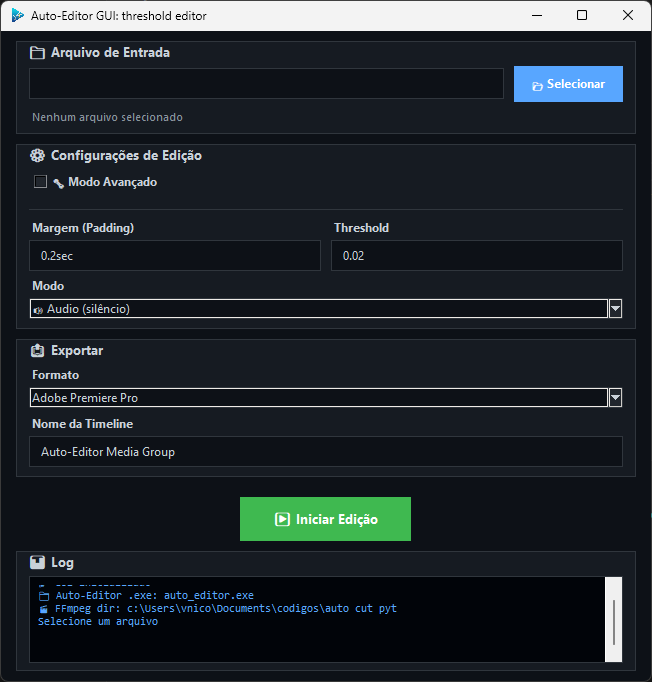

# PrimeTrim (Tauri + TypeScript + Vite)



Interface desktop para o [auto-editor](https://github.com/WyattBlue/auto-editor): seleciona arquivos de vídeo/áudio, ajusta threshold/margem e exporta cortes para Premiere, DaVinci Resolve, Final Cut, ShotCut, Kdenlive ou clip-sequence.

Esta versão é uma reescrita em **Tauri 2 + TypeScript + Vite** da GUI original em Python/Tkinter (mantida em `legacy/` para referência). Os binários `auto_editor.exe`, `ffmpeg.exe`, `ffprobe.exe` e `ffplay.exe` são empacotados como sidecars Tauri.

Todo o corte automático é feito pelo auto-editor, criado por **WyattBlue**. O PrimeTrim é a interface (antes chamado Auto-Cut); a análise, a detecção e a exportação de timeline são dele. O repositório do auto-editor está em domínio público (Unlicense); os binários publicados nas releases embutem outros projetos e seguem as licenças deles.

## Estrutura

```
src/                # frontend TS (Vite)
  tools.ts          # updater: versões, checagem e download de auto-editor/ffmpeg
src-tauri/          # backend Rust (Tauri)
  src/tools.rs      # resolução de binário, download, verificação e instalação
  binaries/         # sidecars: auto_editor / ffmpeg / ffprobe / ffplay (sufixo de target triple)
legacy/             # código Python original
```

## Preview e faixas de áudio

O preview extrai, **uma vez por arquivo**, os dados de todas as faixas de áudio:
um ffmpeg por faixa, rodando em paralelo, e cada um decodifica o arquivo uma só
vez produzindo duas saídas — o WAV tocável e os picos da onda.

Cada faixa vira um `<audio>` próprio tocando junto com o vídeo, que é o relógio.
Por isso ligar e desligar faixa é instantâneo: muda `muted` na camada e a onda é
recalculada no front (máximo ponto a ponto entre as faixas ativas). Nenhum
ffmpeg roda ao clicar numa caixinha.

As camadas não derivam entre si, só largam alguns dezenas de milissegundos
depois do vídeo. Isso é corrigido variando a velocidade em 2% (inaudível com
`preservesPitch`) em vez de dar seek, que abriria um buraco no áudio a cada
ajuste; o seek fica para desvios acima de 250 ms.

Atalhos: **espaço** toca/pausa, **←/→** andam 5s (1s com Shift), **duplo clique**
na caixinha de uma trilha deixa só ela tocando.

A barra de controle é uma linha só — play, régua, tempo e o botão de **prévia do
corte**, que é um interruptor: ligado, a reprodução pula os trechos cortados e o
palco ganha contorno vermelho para a imagem saltando não parecer defeito.

## Logos dos editores

O dropdown de exportação mostra a logo real de cada editor, embutida no bundle
(`src/logos.ts`) como SVG ou data URI — o app roda offline, e um `src` apontando
para fora deixaria a lista sem logo justamente na máquina sem rede.

| Editor | Origem | Licença do arquivo |
| --- | --- | --- |
| Adobe Premiere Pro | Wikimedia Commons | domínio público (PD-textlogo) |
| Final Cut Pro | Wikimedia Commons | domínio público |
| DaVinci Resolve | Simple Icons | CC0 |
| Shotcut | repositório do projeto | GPL-3.0 |
| Kdenlive | repositório do KDE (Breeze) | ícone oficial |

O DaVinci Resolve é o único monocromático: não há versão colorida com licença
livre. Vai num tom claro da marca porque o azul-marinho original (`#233A51`)
desaparece sobre fundo preto.

São marcas registradas de seus donos, usadas apenas para identificar o destino
da exportação.

## Como ler a trilha de cortes

A leitura é por brilho, não por matiz: **o que fica é a onda acesa**, o que sai
vira onda apagada sob um véu vermelho. A régua sólida no topo é o resumo — nela
um corte curto continua visível mesmo quando a onda embaixo já não tem pixels
para mostrá-lo. Passar o mouse mostra o tempo e se aquele ponto é mantido.

Trilha e véu são desenhados no canvas junto com a onda. Eram centenas de `<div>`
posicionados, um por segmento, o que num arquivo com 435 cortes virava DOM demais
para desenhar um pente de 1px.

No **modo simples os cortes se refazem sozinhos** ao mudar qualquer parâmetro —
inclusive em Movimento, que espera um pouco mais antes de rodar porque decodifica
vídeo. Por isso não há botão de re-analisar ali; o aviso de "esses números são de
antes" aparece no próprio resumo. O botão existe só no **modo avançado**, embaixo
do campo de expressão, onde reanalisar a cada tecla digitada não faria sentido.

## Atualizando auto-editor e FFmpeg

O botão de pacote na barra do topo abre **Dependências**: mostra a versão de
cada ferramenta, verifica se há release nova e baixa a atualização.

- **auto-editor** vem das releases do GitHub (`auto-editor-windows-x86_64.exe`).
- **FFmpeg** vem dos builds "essentials" do gyan.dev — mesma origem do
  `ffmpeg.exe` embarcado — e atualiza `ffmpeg`, `ffprobe` e `ffplay` juntos.

O download vai para `%APPDATA%\com.threshold.primetrim\bin\`, e é essa cópia que passa a
ser usada — sem exigir administrador para escrever em `Program Files`. Se ela
não existir, o app usa o sidecar do instalador, como sempre fez. "Restaurar"
apaga a cópia baixada e volta para a embarcada.

Cada binário baixado é executado com `--version` antes de virar o oficial: se
não rodar, a instalação é abortada e nada é substituído. Atualizar durante uma
edição em andamento é recusado (no Windows não se substitui um `.exe` em uso).

Veja [NOTAS-AUTO-EDITOR.md](NOTAS-AUTO-EDITOR.md) para o que mudou nas versões
30.x/31.x do auto-editor e o que ainda dá para aproveitar no app.

## Pré-requisitos

- Node.js 18+
- Rust toolchain (stable) — https://rustup.rs
- Windows 10/11 (sidecars são .exe)
- Webview2 Runtime (já vem no Windows 11)

## Desenvolvimento

```bash
npm install
npm run tauri dev
```

## Build de produção

```bash
npm run tauri build
```

Gera instaladores em `src-tauri/target/release/bundle/` (NSIS `.exe` e MSI).

## Atualização automática do app

O PrimeTrim procura versão nova sozinho alguns segundos depois de abrir (e pelo
botão "Procurar atualização" em **Sobre**). Se houver, mostra as notas da
release e oferece "Atualizar e reiniciar". Não deixa atualizar com um corte
rodando, porque o instalador fecha o app.

Como funciona: o plugin `tauri-plugin-updater` lê
`https://github.com/CakeDev4k/Auto-Editor-Gui/releases/latest/download/latest.json`
e só instala o pacote cuja assinatura bate com o `pubkey` em
`src-tauri/tauri.conf.json`. Sem a chave privada, ninguém consegue empurrar uma
atualização para quem já tem o app instalado — nem quem tiver acesso ao repositório.

### Lançando uma versão

O jeito fácil é o **`gerenciar-atualizacoes.bat`**, um menu que faz tudo abaixo:
ver releases e builds, lançar versão (com confirmação antes do push), abrir o
GitHub para publicar o rascunho, build local assinado para teste e cadastro da
chave nos segredos do repositório. Ele usa o GitHub CLI (`gh`) logado.

O passo a passo manual:

1. Suba a versão em `package.json` (é a única fonte: a `tauri.conf.json` lê dali).
2. Commit, depois `git tag v0.2.0` e `git push --tags`.
3. A action `release` compila, baixa os sidecars nas versões fixadas no
   workflow, assina e cria um **rascunho** de release com o instalador e o
   `latest.json`.
4. Confira o rascunho, escreva as notas e clique em **Publish release**. Só aí
   os apps instalados enxergam a versão nova.

A action precisa de dois segredos no repositório (Settings → Secrets and
variables → Actions): `TAURI_SIGNING_PRIVATE_KEY`, com o conteúdo do arquivo da
chave privada, e `TAURI_SIGNING_PRIVATE_KEY_PASSWORD` (vazio se a chave não tiver senha).

**A chave privada nunca entra no repositório.** Se ela se perder, as versões já
instaladas não aceitam mais nenhuma atualização — guarde uma cópia fora deste
computador.

### Para forks

Um fork que publicar as próprias releases precisa gerar o próprio par de chaves
e apontar o app para o próprio repositório. Senão, os builds do fork vão
procurar atualização no repositório original e recusar as do fork:

```bash
npx tauri signer generate -w ~/.tauri/meu-fork.key
```

Depois troque `plugins.updater.pubkey` (conteúdo do `.key.pub`) e
`plugins.updater.endpoints` em `src-tauri/tauri.conf.json`, e cadastre a chave
privada nos segredos do fork. Para quem só compila localmente nada disso
importa: o app funciona igual, só não acha atualização.

## Como funciona

1. O frontend (Vite/TS) coleta os parâmetros de edição.
2. Invoca o comando Rust `run_editor`, que executa `auto_editor.exe` como sidecar com o `PATH` prefixado pelo diretório dos binários (para que o auto_editor encontre o `ffmpeg.exe`).
3. As linhas de stdout/stderr são emitidas como eventos `editor://line`, classificadas no frontend (info/warning/error/success) e renderizadas no log com cores.
4. `cancel_editor` mata o processo filho via `child.kill()`.

## Versão Python original

O código Python permanece em `legacy/autocutgui.py` e pode ser executado independentemente — veja `legacy/requirements.txt`.

## Ao terminar o corte

Um aviso mostra onde cada arquivo foi parar — nome e pasta, clicáveis para abrir
no explorador. O caminho de saída só existia no log antes, misturado com a saída
do auto-editor, e `_ALTERED` ao lado do original é fácil de não achar depois de
processar uma fila inteira. Tem "não mostrar de novo", guardado no navegador.

O aviso também divulga a [Threshold Multicamera Rush](https://github.com/CakeDev4k/threshold-multicamera-rush),
a extensão irmã que faz corte multicâmera dentro do Premiere.

O card de **Log** recolhe pelo título. A barra de progresso fica de fora do que
recolhe: esconder o texto do log não deve esconder o quanto já foi feito.
